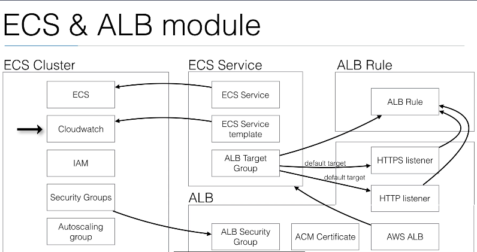

### Modules and resources involved
The high-level service architecture here shows 

- ECS cluster
    - ECS
    - Cloudwatch
    - IAM
    - Security Groups
    - Autoscaling group
- ECS Service
    - ECS Service
    - ECS Service template
    - ALB Target Group
- ALB
    - ALB Security Group
    - ACM certificate
    - AWS ALB
    - HTTP Listener
    - HTTPS Listener
- ALB Rule
    - ALB Rule